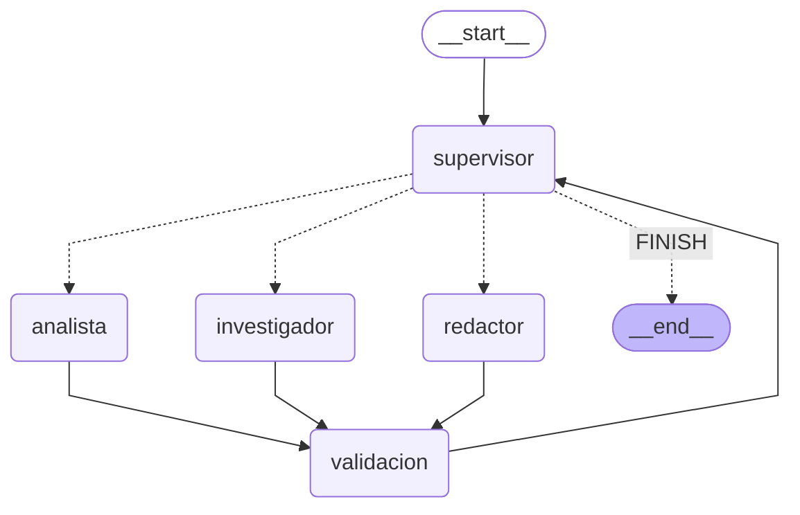

# Orquestador multi-agente de Gobierno de Datos (LangGraph + Claude)

Un **Supervisor** recibe una tarea sobre la calidad de datos de *Mercado Austral S.A.* (una retail ficticia) y decide **dinámicamente** a qué especialista delegarla: un **Investigador** que consulta incidentes y reglas, un **Analista** que calcula vencimientos de SLA y brechas, y un **Redactor** que arma el informe. Un nodo de **Validación** revisa cada aporte antes de que el Supervisor decida el siguiente paso.

Es la pre-entrega 6 del curso de AI Engineering (Coderhouse). Trabajo en el área de Data Governance de una retail, así que elegí un dominio que conozco: priorizar incidentes de calidad de datos es una tarea real, con reglas, plazos y gente a la que hay que explicarle por qué se ataca un incidente antes que otro.

## Cómo probarlo (un solo comando)

Python 3.12 o superior (lo corrí con 3.13).

```bash
python3 -m venv .venv && source .venv/bin/activate && pip install -r requirements.txt && pytest
```

Los tests **no necesitan clave ni red**: usan modelos falsos para la decisión de cada agente y ejecutan las herramientas de verdad contra `data/*.json`. Para correr con Claude real:

```bash
cp .env.example .env            # y pegar la clave de Anthropic en ANTHROPIC_API_KEY
python main.py "Priorizá los incidentes críticos abiertos del maestro de artículos"
python main.py -v "..."         # además muestra la delegación paso a paso
python main.py --demo           # 3 escenarios reales; guarda la traza en trazas/
python main.py --diagrama       # regenera docs/grafo.mmd (y docs/grafo.png si hay red)
mypy .                          # chequeo de tipos (opcional)
```

Para volver a ejecutar el notebook de demostración: `pip install -r requirements-notebook.txt` y abrir `notebooks/demo_delegacion.ipynb` (necesita la clave). Ya está ejecutado y con sus salidas en el repositorio.

## Decisiones de interpretación

Estas son las cosas que el enunciado no fija y que decidí yo. Prefiero que se vean desde el principio:

| Tema | Qué hice y por qué |
|---|---|
| **Agentes especialistas** | `langgraph.prebuilt.create_react_agent` está deprecado en LangGraph 1.x, así que cada especialista es un **subgrafo ReAct propio** (`agents/base.py`: nodo `modelo` ↔ `ToolNode`, con `tools_condition`). Es el mismo patrón, sin depender de una API que se va. |
| **Datos del Investigador** | Datos ficticios propios (`data/`), de solo lectura, sin servicios externos: se corre sin red y sin claves extra. Tavily habría metido ruido de internet en un problema que es de datos internos. Las herramientas son funciones propias con acceso a esa "base". |
| **Días hábiles** | Lunes a viernes, **sin feriados** (los datos son ficticios). Una jornada son 8 horas. Se cuenta desde la fecha de alta (inclusive) hasta la fecha de corte (exclusive). |
| **Prioridad de incidentes** | Severidad > SLA vencido > horas de exceso > registros afectados > ID (desempate estable). |
| **`pasos`** | Cuenta las **delegaciones** a especialistas. La decisión de cerrar (`FINISH`) no consume un paso. `MAX_PASOS=10` significa "como máximo 10 delegaciones por tarea". |
| **Temperatura** | No la envío: la API de Anthropic la rechaza con este modelo (error 400). Queda el valor del servicio. Por eso las pruebas de decisión se hacen con modelos falsos y no dependo de que el modelo real sea determinista. |
| **Refinamientos** | Cuando el Supervisor vuelve a pedirle algo a un especialista, el resultado **se suma** a lo anterior (por ID) en lugar de reemplazarlo. Lo descubrí en la primera corrida real (ver "Evidencia"). |
| **Fallas de la API** | Un corte de red, un límite de uso o un error del servidor **no tiran abajo el grafo**: el nodo convierte la falla en un aporte vacío con el error (`Contribucion.error`), la validación lo rechaza y el Supervisor decide si reintenta, dentro de sus topes. Si el que falla es el Supervisor, sigue el orden lógico y lo deja registrado en la decisión. Los errores que reintentar no arregla (clave inválida, modelo inexistente: HTTP 400/401/403/404) **sí suben**, para que `main.py` le diga al usuario qué cambiar. Los modelos reales se crean con timeout de 60 s y 2 reintentos (`ejecucion.crear_llm`). |
| **Fuera de alcance** | Si la consulta no tiene que ver con incidentes ni reglas, el Investigador responde con el marcador explícito `FUERA_DE_ALCANCE`. Sin ese marcador, "no encontré nada" y "no corresponde" serían indistinguibles y la validación no podría aprobar legítimamente una respuesta sin datos. |

## Arquitectura


El diagrama sale de `grafo.get_graph()`: `draw_mermaid()` da el texto (`docs/grafo.mmd`) y `draw_mermaid_png()` el PNG; `python main.py --diagrama` hace las dos cosas. El `docs/grafo.png` del repositorio lo rendericé con `mmdc` (mermaid-cli) a partir de ese mismo texto, porque `draw_mermaid_png()` depende de un servicio web. Las líneas punteadas son las **aristas condicionales**:



| Nodo | Qué hace | Qué no hace |
|---|---|---|
| `supervisor` | Lee un **resumen** del trabajo y elige el próximo destino con `with_structured_output(DecisionSupervisor)`, un `Literal` (`investigador`, `analista`, `redactor`, `FINISH`) más una instrucción y un motivo. | No consulta datos, no calcula, no redacta. |
| `investigador` | Busca incidentes y trae ficha y regla. Tools: `buscar_incidentes_calidad`, `detalle_incidente`, `consultar_regla_calidad`. | No calcula ni redacta. |
| `analista` | Calcula vencimiento de SLA, brecha de cada regla y ranking de prioridad. Tools: `calcular_vencimiento_sla`, `calcular_brecha_regla`, `priorizar_incidentes`. | No consulta datos: recibe los del Investigador. |
| `redactor` | Escribe el informe con los datos ya validados. Sin tools. | No inventa números ni IDs. |
| `validacion` | Aplica la rúbrica al último aporte con **código determinista** y deja el veredicto en el estado. | No usa un modelo. |

La función de ruteo (`graph.decidir_ruta`) devuelve un `Literal["investigador", "analista", "redactor", "FINISH"]` y es la única arista condicional del grafo. **No hay rutas fijas entre especialistas**: un especialista siempre vuelve al Supervisor pasando por la validación.

## Por qué esta topología

Elegí un **supervisor jerárquico** (en lugar de una cadena fija o de agentes que se hablan entre sí) por tres razones:

1. **La tarea no tiene un único camino.** Si no hay incidentes que cumplan el filtro, o la consulta está fuera de alcance, el Analista sobra. Una cadena fija obligaría a ejecutarlo igual; con un supervisor, el camino lo decide la situación (lo muestran los escenarios 1, 2 y 3 de la demo).
2. **Un único punto de decisión es fácil de acotar y de auditar.** Todo el control de flujo (tope de pasos, intentos, dependencias) está en un solo nodo, y cada decisión queda registrada con su motivo.
3. **El refinamiento sale gratis.** Si un aporte es rechazado, el Supervisor puede volver a pedirlo con una instrucción concreta; en una cadena fija habría que cablear cada reintento.

El costo es una llamada extra al modelo por cada vuelta del Supervisor. Lo compenso con un modelo chico (Haiku) y un contexto mínimo para el Supervisor.

## Cómo se manejan los conflictos entre agentes

Un "conflicto" acá es que un agente entregue algo que contradice los datos o lo que hizo otro. Lo resuelvo en capas:

- **Los datos viajan por el estado, no por el texto del modelo.** `Hallazgos` y `Analisis` se arman a partir de los `ToolMessage` (lo que devolvieron las herramientas), no de lo que el modelo cuenta que hizo. Un agente no puede "afirmar" un dato que no consultó.
- **Pydantic valida la forma; el código valida la verdad.** Los contratos son inmutables (`frozen=True`) y la validación **recalcula** las cifras del Analista con los datos del Investigador (`calculos.py`). Si el Analista copió mal una fecha, el cálculo es válido en forma pero no coincide: se rechaza con el problema concreto.
- **El Redactor no puede contradecir al Analista.** El informe se rechaza si cita IDs que no existen, si omite un incidente analizado o si no nombra el de mayor prioridad.
- **Los refinamientos suman, no reemplazan.** Si el Supervisor pide "completá las reglas", los incidentes ya recolectados siguen en el estado (`Hallazgos.fusionar`, `Analisis.fusionar`). Los errores y el resumen son siempre los de la última corrida.
- **Un aporte aprobado puede quedar vencido.** Si el Investigador vuelve a entregar después de que el Analista fue aprobado, el cálculo del Analista ya no vale y hay que rehacerlo (`supervisor.aprobado`).
- **Escritura aislada por nodo.** Cada nodo solo puede escribir las claves de su parcela (`state.CLAVES_POR_NODO`); un test lo verifica en cada corrida.
- **Si no hay acuerdo, el sistema no inventa.** Con `MAX_INTENTOS_POR_AGENTE` agotado, el estado final es `validacion_fallida` y la respuesta lista los problemas pendientes en lugar de entregar un informe sin aprobar.

## Estado compartido (`state.py`)

`EstadoOrquestador` hereda de `MessagesState` y registra **quién aportó qué**:

| Campo | Dueño | Para qué |
|---|---|---|
| `tarea`, `messages` | entrada | La consulta del usuario. |
| `siguiente`, `instruccion`, `pasos`, `intentos`, `decisiones` | `supervisor` | Destino, instrucción, contadores y el registro de cada decisión (con motivo y, si la hubo, la corrección de una guarda). |
| `hallazgos` | `investigador` | Incidentes, reglas y herramientas usadas. |
| `analisis` | `analista` | Vencimientos, brechas, ranking. |
| `informe` | `redactor` | Texto final propuesto. |
| `validacion`, `validaciones` | `validacion` | Veredicto sobre el último aporte e historial. |
| `contribuciones` | especialistas | Qué aportó cada agente: resumen, herramientas y error si lo hubo. |
| `estado_final`, `respuesta_final` | `supervisor` | `completado`, `limite_de_pasos` o `validacion_fallida`, y la respuesta. |

`intentos`, `decisiones`, `validaciones` y `contribuciones` usan **reducers** (`operator.add` y un `sumar_contadores` propio) para acumular sin que un nodo pise lo de otro.

## Errores que el diseño evita

| Riesgo | Cómo lo evito |
|---|---|
| **Supervisor infinito** | `MAX_PASOS` (delegaciones) y `MAX_INTENTOS_POR_AGENTE`, forzados por **código** (`supervisor.aplicar_guardas`), no por el prompt. Al llegar al tope el sistema cierra con un mensaje claro. El `recursion_limit` de LangGraph (`3·MAX_PASOS + 5`) queda como red de seguridad: nunca es lo que corta. |
| **Contaminación de contexto** | Cada especialista arranca con **un único mensaje**; el Analista recibe solo el JSON que necesita (no la conversación del Investigador); el Redactor recibe la tarea y datos ya validados; el Supervisor recibe un **resumen textual**, nunca datos crudos. Tests lo verifican. El historial `messages` solo suma **un mensaje corto por aporte**, así que crece a lo sumo con `MAX_PASOS` y no hace falta recortarlo por tokens. |
| **Supervisor que hace el trabajo de otros** | No tiene herramientas y su prompt lo define como "director de tráfico". Además su salida es un `Literal`: solo puede elegir a quién mandar. |
| **El modelo se salta pasos o cierra antes de tiempo** | Las guardas corrigen la decisión (cerrar sin informe aprobado, redactar sin analizar) y la corrección **queda registrada** en `decisiones` (`corregida_por_guarda`, `razon_guarda`) y en la traza. Una salida inválida del modelo cae al orden lógico. |
| **Excepciones sin capturar en un nodo** | Los tres especialistas y el Supervisor capturan las fallas transitorias del modelo (ver "Fallas de la API" en las decisiones); las herramientas devuelven los errores como JSON con una ayuda para que el agente corrija la llamada, no como excepciones; el `ToolNode` usa `handle_tool_errors=True`; y un especialista que se pasa de su tope de pasos devuelve un aporte rechazable en lugar de levantar `GraphRecursionError`. |

## Rúbrica de validación

El nodo `validacion` (`validacion.py`) es código puro, sin modelo:

- **Investigador:** usó al menos una herramienta (o declaró `FUERA_DE_ALCANCE`), pidió el detalle de los incidentes listados, consultó la regla de cada uno y tiene la fecha de corte.
- **Analista:** calculó el vencimiento de **cada** incidente y la brecha de **cada** regla, y su ranking coincide con el que resulta de recalcular con los datos del Investigador.
- **Redactor:** el informe no está vacío, no cita IDs inventados, cubre todos los incidentes analizados y nombra el de mayor prioridad.

El veredicto va al estado y el Supervisor lo lee en su resumen (aprobado o rechazado, con los problemas). Si el Supervisor intentara cerrar, el código verifica antes que el informe haya sido aprobado.

## Qué pruebo y qué no

- **Tests (`pytest`, sin red):** contratos, cálculos, herramientas (reales), agentes, validación, guardas del Supervisor, el **grafo completo** con modelos falsos (camino feliz, sin incidentes, fuera de alcance, refinamiento, intentos agotados, tope de pasos, salida inválida o falla de la API del supervisor y de cada especialista, aislamiento de escritura y de contexto), traza, CLI, configuración y seguridad del repo (sin claves, `.gitignore`, dependencias fijadas, anotaciones de tipo). También hay un test de la **evidencia de dos o más llamadas a herramientas encadenadas** entre agentes.
- **Prueba de mutación (`python scripts/mutacion.py`):** inyecto errores deliberados (un `>=` que pasa a `>`, una validación que se saltea, una arista mal cableada) en una copia del código y exijo que los tests fallen. Resultado actual: **46 mutantes, 46 detectados**. En la primera pasada sobrevivieron 3 (los tests no miraban esos comportamientos) y, al sumar la fusión de refinamientos, sobrevivió uno más; en cada caso agregué el test que faltaba. Los últimos seis mutantes sacan el resguardo contra fallas de la API de cada nodo.
- **Lo que los tests NO prueban:** que *Claude* decida bien. Con modelos falsos verifico que el grafo enruta, delega, valida, refina y corta donde corresponde; que el modelo real elija bien se ve en la corrida real (siguiente sección).

## Evidencia de una corrida real

Corrí el orquestador con **Claude real** (`claude-haiku-4-5` para todos los agentes) sobre tres tareas. La traza completa está en [`trazas/traza-demo.log`](trazas/traza-demo.log) (legible) y [`trazas/traza-demo.json`](trazas/traza-demo.json) (estructurada). El flujo también quedó ejecutado, celda por celda, en [`notebooks/demo_delegacion.ipynb`](notebooks/demo_delegacion.ipynb): es **otra corrida real** de los mismos tres escenarios, así que los números (tokens, redacción) difieren un poco; la delegación fue la misma.

| Escenario | Delegación que decidió el Supervisor | Resultado | Llamadas al modelo | Tokens (entrada / salida) |
|---|---|---|---|---|
| 1. Priorizar críticos de artículos | investigador → analista → redactor → cierre | INC-1001 primero (276 h de exceso, 312 registros), después INC-1002 (68 h) | 12 | 29.698 / 2.726 |
| 2. Incidentes abiertos de proveedores | investigador → analista → redactor → cierre | INC-2001 (164 h), INC-2002 (56 h), INC-2003 dentro del plazo | 12 | 32.456 / 3.318 |
| 3. Consulta fuera de alcance (empleados y sueldos) | investigador → redactor → cierre (**se saltea al analista**) | Responde que no es de su dominio y no inventa datos | 5 | 7.617 / 686 |

En los tres casos el Supervisor fijó el camino por su cuenta, cada aporte fue aprobado por la validación y ninguna guarda tuvo que corregir una decisión. Cada especialista usó solo sus herramientas: el Investigador consultó (`buscar_incidentes_calidad`, `detalle_incidente`, `consultar_regla_calidad`) y el Analista calculó (`calcular_brecha_regla`, `calcular_vencimiento_sla`, `priorizar_incidentes`). Esas cadenas de llamadas, en secuencia y entre dos agentes, son la evidencia de delegación.

### Una corrida paso a paso (escenario 1)

Extracto de [`trazas/traza-demo.log`](trazas/traza-demo.log), recortado (en el log completo están también la instrucción que recibió cada agente y su resumen). Los motivos son textuales: los escribió el Supervisor, no yo.

```
Tarea: "Necesito saber qué incidentes críticos abiertos tiene el maestro de artículos, qué regla incumple cada uno,
        cuánto se pasaron del plazo (SLA) y cuál conviene atacar primero. Armame un informe corto."

[Paso 1] Supervisor → investigador
           Motivo: Primer paso: recolectar datos sobre incidentes críticos abiertos y sus reglas asociadas en el maestro de artículos.
           Investigador usó: buscar_incidentes_calidad, detalle_incidente x2, consultar_regla_calidad x2
           Validación: APROBADA
[Paso 2] Supervisor → analista
           Motivo: El investigador aprobó y encontró 2 incidentes críticos con ficha completa. Es momento de analizar brechas, vencimiento de SLA y prioridad.
           Analista usó: calcular_brecha_regla x2, calcular_vencimiento_sla x2, priorizar_incidentes
           Validación: APROBADA
[Paso 3] Supervisor → redactor
           Motivo: El investigador y el analista validaron sus aportes. [...] El análisis está completo y listo para redactar.
           Redactor usó: ninguna
           Validación: APROBADA
[Cierre] Supervisor → FINISH (cierra la tarea)

Estado final: completado | delegaciones: 3 | agentes: investigador, analista, redactor
```

Lo que se ve ahí: el Supervisor eligió el destino de cada paso mirando el resumen del trabajo (no una receta fija), el Analista calculó con las herramientas lo que el Investigador había recolectado, y cada aporte pasó por la validación antes de que el Supervisor decidiera. La respuesta final nombra a INC-1001 como prioritario (276 h hábiles de exceso, 312 registros) y a INC-1002 en segundo lugar (68 h).

### Lo que encontró la primera corrida real

La primera vez que corrí la demo, el escenario 1 salió **mal** y lo conservé como evidencia: [`docs/evidencia/corrida-1-bug-refinamiento.log`](docs/evidencia/corrida-1-bug-refinamiento.log).

1. El Investigador encontró los 2 incidentes, pero la validación lo rechazó porque faltaba consultar sus reglas (el mecanismo de rechazo funcionó).
2. El Supervisor pidió completar las reglas y el Investigador consultó **solo** las reglas.
3. Mi nodo **reemplazó** los hallazgos del paso 1 por los del paso 2: los incidentes desaparecieron del estado. El Supervisor vio "0 incidentes", se salteó al Analista y el Redactor informó que no había incidentes críticos. La validación lo aprobó, porque "consultó una herramienta y no hay incidentes" es un resultado válido.

Los tests con modelos falsos no lo habían detectado: ninguno simulaba un refinamiento que devolviera solo una parte. El arreglo fue de diseño: **un refinamiento completa lo recolectado antes, no lo reemplaza** (`Hallazgos.fusionar` y `Analisis.fusionar` en `state.py`, por ID y con lo nuevo pisando campo a campo). Agregué los tests que reproducen exactamente ese caso, mutantes que revierten el arreglo (y se detectan) y dos ajustes de prompt: el Investigador no termina hasta tener ficha y regla de cada incidente, y el Redactor no inventa categorías como "en riesgo". La corrida de la tabla de arriba es la posterior al arreglo.

## Estructura del repositorio

```
state.py              estado compartido (TypedDict sobre MessagesState) y contratos Pydantic
graph.py              StateGraph: nodos, aristas y la función de ruteo con Literal
supervisor.py         nodo Supervisor: decisión estructurada + guardas + resumen de contexto
validacion.py         nodo de Validación: rúbrica determinista
calculos.py           días hábiles, vencimiento de SLA, brecha y prioridad (funciones puras)
repositorio.py        acceso de solo lectura a data/*.json
agents/
  base.py             subgrafo ReAct reutilizable y utilidades de mensajes
  research_agent.py   Investigador y sus herramientas
  analyst_agent.py    Analista y sus herramientas
  writer_agent.py     Redactor
ejecucion.py          modelos reales, ejecución de una tarea, diagrama
trazas.py             traza legible de la delegación (JSON y log)
main.py               línea de comandos
data/                 datos ficticios de Mercado Austral (incidentes y reglas), de solo lectura
notebooks/demo_delegacion.ipynb   demostración ejecutada del flujo de delegación
trazas/               traza de la corrida real (traza-demo.json y .log)
docs/                 diagrama del grafo (grafo.mmd y grafo.png) y evidencia/ con la primera corrida real
scripts/mutacion.py   prueba de mutación
tests/                suite de pruebas (modelos falsos en tests/fakes.py)
requirements.txt      dependencias fijadas, incluidas las de las pruebas (un solo comando)
requirements-notebook.txt   extras para volver a ejecutar el notebook
Makefile              atajos: make todo | test | tipos | demo | diagrama
.env.example          variables de entorno (sin claves)
pyproject.toml        configuración de pytest y mypy
```

## Mapa a la rúbrica

| Criterio | Dónde está |
|---|---|
| **Documentación y visualización (20%)** | Este README, diagrama Mermaid (`docs/`), explicación de la topología y del manejo de conflictos, notebook ejecutado y traza real. |
| **Arquitectura y flujo del grafo (35%)** | `graph.py`: `StateGraph` + `add_conditional_edges` con `decidir_ruta -> Literal[...]`; `supervisor.py`: decisión dinámica con salida estructurada, guardas y topes. |
| **Especialización de agentes y herramientas (25%)** | `agents/`: 3 especialistas con prompts y herramientas propias, sin herramientas compartidas (un test lo verifica); herramientas funcionales sobre los datos. |
| **Gestión de estado y validación (20%)** | `state.py` (contratos, reducers, escritura por parcela) y `validacion.py` (rúbrica determinista que recalcula). |

## Límites conocidos

- Los datos son ficticios y están en JSON; el repositorio es de solo lectura.
- Los días hábiles no descuentan feriados.
- Un solo proveedor de modelos (Anthropic). El diseño permite cambiarlo (los agentes reciben un `BaseChatModel`), pero no lo probé con otro.
- La traza de la corrida real es una muestra: la decisión del Supervisor depende del modelo y puede variar entre corridas.
